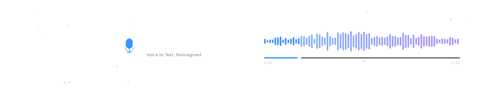

# Saytype

Push-to-talk dictation for macOS. Hold a key, talk, let go, and the text lands at your cursor. Speech recognition runs offline on Apple Silicon with NVIDIA Parakeet, and Saytype retrains that model on the names and terms you give it. Apple's on-device Foundation Models can then tidy up each transcript before it's pasted.

<p align="center">
  <picture>
    <source media="(prefers-color-scheme: dark)" srcset="https://github.com/RaphaelMitas/saytype/releases/latest/download/screenshot-words-dark.png">
    
  </picture>
  <picture>
    <source media="(prefers-color-scheme: dark)" srcset="https://github.com/RaphaelMitas/saytype/releases/latest/download/screenshot-history-dark.png">
    
  </picture>
  <picture>
    <source media="(prefers-color-scheme: dark)" srcset="https://github.com/RaphaelMitas/saytype/releases/latest/download/screenshot-post-processing-dark.png">
    
  </picture>
  <picture>
    <source media="(prefers-color-scheme: dark)" srcset="https://github.com/RaphaelMitas/saytype/releases/latest/download/screenshot-general-dark.png">
    
  </picture>
</p>

## What it does

**Retrains Parakeet on your words.** Add a term like "Kubernetes" on the Words page and Saytype fine-tunes the model's decoder and joint network on this Mac, in about a minute per word. It trains on synthetic speech of each word plus recordings of your own voice. If Saytype mishears something, click the word in History to teach it the right spelling from that recording. Training runs in the background, and dictation keeps working while it does.

**Cleans up with Apple Foundation Models.** Post-processing sends each transcript to Apple Intelligence's on-device model before pasting. The built-in "Clean up" prompt fixes punctuation, writes numbers as digits and drops the ums. You can write your own prompts too. If the model fails or takes too long, Saytype pastes the raw text.

**Stays on your machine.** No account, no cloud. Audio and transcripts never leave the Mac unless you point Saytype at your own server.

**Shows you what it heard.** A small panel at the bottom of the screen previews the transcript while you hold the key.

**Runs one Mac as a server.** Put a Mac in Server mode and other machines on your network send their audio to it. That includes Windows PCs, which run Saytype as a client.

It also updates itself in the background and installs the update when you restart or quit.

## Installation

### macOS

```bash
brew install raphaelmitas/tap/saytype
```

Or download the zip from [GitHub Releases](https://github.com/RaphaelMitas/saytype/releases), unzip it and drag `Saytype.app` to Applications.

Requires an Apple Silicon Mac on macOS 11 or later. Post-processing needs macOS 26 with Apple Intelligence turned on.

### Windows

Download the `.msi` or setup `.exe` from [GitHub Releases](https://github.com/RaphaelMitas/saytype/releases). Windows has no local model, so it needs a Mac running Saytype in Server mode. Enter that Mac's URL on the Mode page.

## Usage

1. Launch Saytype. It lives in the menu bar.
2. Grant Microphone, Accessibility and Input Monitoring on first launch.
3. Hold Right Command to record. You can pick a different hotkey in Settings.
4. Release, and the text is pasted at your cursor. Your clipboard comes back afterwards.

On first launch the model takes a moment to load. Saytype plays a sound when it's ready, and Settings shows the status.

## Building from source

### Prerequisites

- [Rust](https://rustup.rs/)
- [Node.js](https://nodejs.org/) 20+
- [pnpm](https://pnpm.io/)
- Python 3.14 (`brew install python@3.14`)
- Xcode 26 or later for post-processing. Older SDKs still build, but post-processing reports itself unsupported.

### Build

```bash
# Install dependencies
pnpm install

# Development (hot reload, builds the ML sidecar on first run)
pnpm tauri dev

# Production build (needs the sidecar from a dev run or sidecar/build.sh)
pnpm tauri build
```

The built app will be at `src-tauri/target/release/bundle/macos/Saytype.app`.

## Architecture

- **Tauri/Rust** handles the hotkey, audio capture, pasting, and calls Foundation Models through a small Swift bridge.
- **Python sidecar** runs Parakeet MLX for transcription and trains the custom-word head.
- **React frontend** is the settings UI and the preview panel.

## Acknowledgements

Speech recognition powered by [NVIDIA Parakeet TDT](https://huggingface.co/nvidia/parakeet-tdt-0.6b-v3), licensed under CC-BY-4.0.
